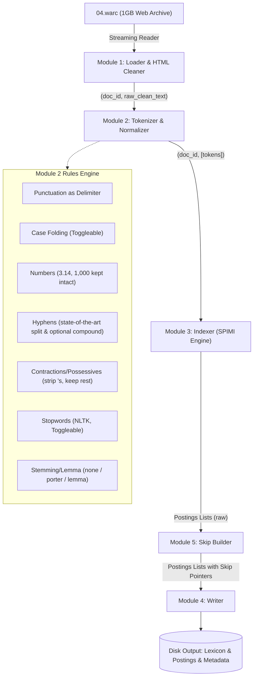
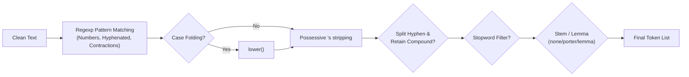
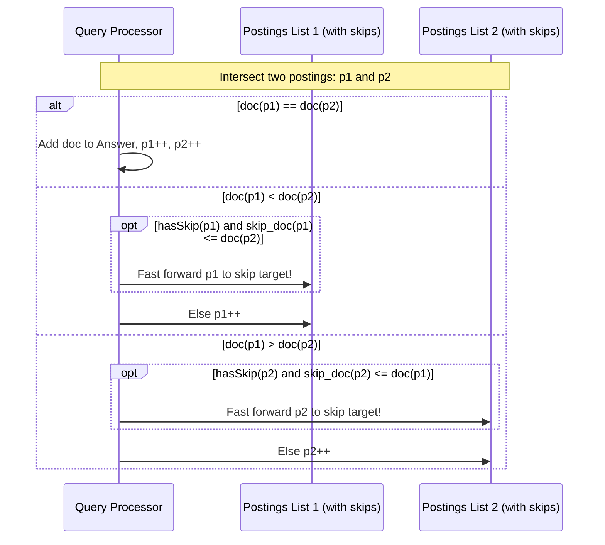

# Inverted Index System Architecture & Implementation Plan
> **Course / Project**: 26FW Information Retrieval - HW1  
> **Target Dataset**: `HW1/04.warc` (~1.05 GB ClueWeb09 Crawl)  
> **Output Location**: `HW1/plans/inverted_index_plan.md`  
> **Target Language**: Python 3.12+

---

## 1. 專案目標與整體架構 (Overview & Architecture)

本專案旨在針對大規模 Web 語料庫（`HW1/04.warc`，大小約 1GB 之 ClueWeb09 格式資料）建構一套模組化、高效率且具備跳表（Skip Pointers）的倒排索引（Inverted Index）系統。

全系統嚴格劃分為五大模組：
1. **Loader & 資料前處理 (Loader & Preprocessor)**：高效率串流讀取 WARC 檔案，提取網頁內文並清洗 HTML。
2. **斷詞與規範化 (Tokenizer & Normalizer)**：基於 NLTK 與客製正規表達式，依規格處理標點、大小寫、數字、連字號、所有格、停用詞與詞幹還原。
3. **倒排索引構建器 (Indexer)**：管理詞彙表（Lexicon）與過帳清單（Postings List），支援記憶體控制與 SPIMI（Single-Pass In-Memory Indexing）。
4. **索引持久化與序列化 (Writer)**：將記憶體中的索引儲存至硬碟，支援雙重輸出格式（除錯用文字/JSON 格式與高效二進制壓縮格式）。
5. **跳表構建器 (Skip Builder)**：為過帳清單建立 Skip Pointers（跳躍指標），並提供具備跳表優化的布林查詢求交（AND Intersection）演算法以驗證效能。

### 1.1 系統架構與資料流 (System Pipeline)



---

## 2. 模組規格與詳細設計 (Module Specifications)

### 模組 1：Loader & 資料前處理 (Loader & Data Preprocessor)
> 詳見詳細執行計畫：[`HW1/plans/module_1_loader_plan.md`](file:///Users/kuan/Desktop/26FW-Information-Retrieval/HW1/plans/module_1_loader_plan.md)


#### 1. 職責與挑戰
- **檔案規格**：`HW1/04.warc` 屬於 ClueWeb09 WARC 0.18 規範，包含 `warcinfo` 區塊與成千上萬筆 `response` 記錄。
- **記憶體挑戰**：檔案大小高達 1.05 GB，絕對**不可一次性讀入記憶體**，必須採用 Generator（產生器）進行串流逐筆解析。
- **HTML 萃取**：需跳過 HTTP Header（`HTTP/1.1 200 OK` 等），萃取 HTML Body，並濾除 `<script>`, `<style>`, 導航標籤等非內容文字，修復亂碼編碼（ftfy）。

#### 2. 核心功能
- **WARC 解析器**：
  - 過濾條件：僅保留 `WARC-Type: response`，其餘（`warcinfo`, `request` 等）直接跳過。
  - Document ID 提取：優先提取 `WARC-TREC-ID`（例如 `clueweb09-en0000-04-00000`），若無則以 `WARC-Record-ID` 替代。
- **HTML 清理與文字抽取**：
  - 使用 `lxml` / `BeautifulSoup4` 快速過濾純文字。
  - 移除標籤：`<script>`, `<style>`, `<!-- comments -->`, `<noscript>`。
  - 特殊字元與編碼還原：利用 `html.unescape` 與 `ftfy.fix_text` 修復 Mojibake 亂碼。

#### 3. 介面定義
```python
class WarcLoader:
    def __init__(self, warc_path: str):
        self.warc_path = warc_path

    def stream_documents(self) -> Generator[tuple[str, str], None, None]:
        """
        Yields:
            (doc_id, clean_text)
        """
        pass
```

---

### 模組 2：斷詞與規範化 (Tokenizer & Normalizer)

本模組嚴格依據作業指示所要求的七大前處理規則實作，並具備高可設定性（Configurable Flags）。

#### 1. 前處理規則實作細節

| 規則項目 | 處理規格 | 實作策略與正規表達式 / NLTK 函式 |
| :--- | :--- | :--- |
| **1. 標點符號** | 一律當分隔符號丟棄 | 在斷詞過程中作為 token 界線排除，非字母數字/特定模式符號一律捨棄。 |
| **2. 大小寫 (Case Folding)** | 轉為全小寫（可開關） | 提供開關 `case_folding: bool = True`。開啟時執行 `.lower()`。 |
| **3. 數字 (Numbers)** | 保留，`3.14`、`1,000` 視為單一 token | 保留浮點數、千分位逗號數值，如 `\d+(?:,\d{3})*(?:\.\d+)?` 或 `\d+\.\d+`。不可拆成 `["3", "14"]` 或 `["1", "000"]`。 |
| **4. 連字號 (Hyphens)** | `state-of-the-art` 拆成 `state` / `of` / `the` / `art`（進階：同時保留合併詞） | 基本模式：以 `-` 作為分隔，拆解出各個單詞。<br>進階模式開關 `retain_compounds: bool`：若開啟，同時產生個別子詞及合併詞 `["state", "of", "the", "art", "stateoftheart"]`。 |
| **5. 縮寫 / 所有格 (Contractions / Possessives)** | `don't`、`John's` 去掉 `'s`，其餘保留 | 規則：<br>1. 若結尾為 `'s` 或 `’s`，直接剝除（`John's` $\to$ `John`）。<br>2. 其餘縮寫（如 `don't`, `can't`, `we've`）保留為單一單詞 `dont` / `cant` 或保留原形（依需求可設定，標準規範去撇號保留單字主體）。 |
| **6. 停用詞 (Stopword)** | 可開關，使用 NLTK 英文停用詞表 | 提供開關 `remove_stopwords: bool = True`。<br>使用 `nltk.corpus.stopwords.words('english')` 過濾。注意：大小寫轉換後再進行比對。 |
| **7. 詞幹 / 詞形還原 (Stem/Lemma)** | 可選 `none` / `porter` / `lemma` | 提供參數 `stemming_mode: Literal["none", "porter", "lemma"]`：<br>• `"none"`: 不進行還原<br>• `"porter"`: 使用 `nltk.stem.PorterStemmer()`<br>• `"lemma"`: 使用 `nltk.stem.WordNetLemmatizer()` (預設詞性還原) |

#### 2. Tokenizer 資料流示意


#### 3. 介面定義
```python
from dataclasses import dataclass
from typing import Literal

@dataclass
class TokenizerConfig:
    case_folding: bool = True
    keep_numbers: bool = True
    split_hyphens: bool = True
    retain_compounds: bool = False
    strip_possessives: bool = True
    remove_stopwords: bool = True
    stemming_mode: Literal["none", "porter", "lemma"] = "none"

class WarcTokenizer:
    def __init__(self, config: TokenizerConfig):
        self.config = config
        # 初始化 NLTK 元件 (stopwords, porter, wordnet)
        
    def tokenize(self, text: str) -> list[str]:
        """執行上述規則之斷詞與正規化"""
        pass
```

---

### 模組 3：倒排索引構建器 (Indexer)

#### 1. 職責與資料結構
- **內部 DocID 映射**：將字串格式的 `WARC-TREC-ID` 映射為從 `0` 開始連續遞增的整數 `doc_num`，減少記憶體使用量並便利 Delta 編碼。
- **過帳清單（Posting List）結構**：
  - 基本結構：`Posting(doc_id: int, term_frequency: int)`
  - 進階/位置結構（選用）：`Posting(doc_id: int, tf: int, positions: list[int])`
- **字典（Lexicon / Dictionary）**：
  - 記錄：`term -> {"df": document_frequency, "postings": list[Posting]}`
- **單次通過記憶體索引（SPIMI 策略）**：
  - 考量 1GB WARC 解開後純文字量可能達數百 MB，若全量存放記憶體可能占用大量 RAM。
  - 設計記憶體閾值機制：當記憶體使用達到上限（或處理達到 $M$ 篇文件）時，將 Partial Index 寫入臨時磁區，最後執行 Multi-way Merge（多路合併）。若記憶體充足，亦可直接在記憶體中維護完整索引。

#### 2. 統計數據維護
- 總文件數 $N$
- 總 Token 數（Total Term Occurrences）
- 詞彙表大小 $|V|$（Vocabulary Size）
- 每篇文件的長度 $|d|$（Document Length）及平均長度 $avg\_doc\_len$

#### 3. 介面定義
```python
class Indexer:
    def __init__(self):
        self.doc_id_map: dict[str, int] = {}
        self.doc_lengths: dict[int, int] = {}
        self.inverted_index: dict[str, list[int]] = {}  # term -> list of doc_ids (or Postings)

    def add_document(self, external_doc_id: str, tokens: list[str]) -> None:
        pass

    def get_stats(self) -> dict:
        pass
```

---

### 模組 4：索引寫入與持久化 (Writer)

#### 1. 輸出檔案設計
為滿足測試驗證與檢索效能，Writer 將提供兩套輸出格式：
1. **可讀性格式 (Human-readable / Inspection format)**：
   - `postings.json` 或 `postings.txt`：方便檢查 token 規則與跳表結果。
2. **高效二進制格式 (Binary / Inverted File format)**：
   - `lexicon.idx`：每個詞的偏移量與長度（Term, Document Frequency $df$, Posting Offset, Posting Byte Length）。
   - `postings.bin`：連續的 Postings 陣列（使用 32 位元整數或 Variable-Byte / VByte 壓縮）。
   - `doc_ids.json`：`doc_num <-> WARC-TREC-ID` 雙向映射表。
   - `metadata.json`：儲存統計量（$N$、平均文件長度、參數設定等）。

#### 2. 磁碟佈局範例 (HW1/output/)
```text
HW1/output/
├── metadata.json           # 總文檔數、詞彙數、建立時間、斷詞設定參數
├── doc_map.json            # internal_id -> clueweb09_id 與 document length
├── lexicon.tsv             # term \t df \t byte_offset \t byte_length
└── postings.bin            # 二進制倒排清單（包含 Skip Pointers）
```

#### 3. 介面定義
```python
class IndexWriter:
    def __init__(self, output_dir: str):
        self.output_dir = output_dir

    def write_text_format(self, indexer: Indexer, filename: str = "index_dump.txt") -> None:
        pass

    def write_binary_format(self, indexer: Indexer) -> None:
        pass
```

---

### 模組 5：跳表構建器 (Skip Builder)

#### 1. 跳表原理與間隔策略
跳表（Skip Pointers）用於加速兩個倒排清單進行布林 AND 查詢時的求交集（Postings Intersection）速度，無需線性逐一走訪每個節點。

- **間隔長度選擇 (Skip Interval $L$)**：
  根據 Manning 等人的經典教科書《Introduction to Information Retrieval》，對於長度為 $P$ 的 Postings List，最佳固定間隔步長約為：
  $$L = \lfloor \sqrt{P} \rfloor$$
- **門檻限制**：
  若 Postings List 太短（例如 $P < 4$ 或 $P < 9$），建立 Skip Pointer 的效益低於額外開銷，可不建立 Skip Pointer。

#### 2. 資料結構設計
對於過帳清單 `[doc_1, doc_2, ..., doc_n]`：
- 每個有 Skip Pointer 的節點，記錄 `(target_doc_id, target_index)`。
- 跳表可直接儲存為輔助清單，例如：
  - Postings: `[2, 4, 8, 16, 19, 23, 28, 43]`
  - Skip Links (間隔 $\lfloor \sqrt{8} \rfloor = 2$):
    - index 0 (doc 2) $\to$ skip to index 2 (doc 8)
    - index 2 (doc 8) $\to$ skip to index 4 (doc 19)
    - index 4 (doc 19) $\to$ skip to index 6 (doc 28)

#### 3. 查詢驗證演算法 (IntersectWithSkips)


#### 4. 效益評估指標
- 比較運算次數（Number of doc_id comparisons）
- 查詢時間耗時（Query execution time in milliseconds）

---

## 3. 專案目錄結構規劃 (Project Structure)

在 `HW1` 目錄下建立標準 Python 模組架構：

```text
HW1/
├── 04.warc                      # 原始 WARC 語料庫 (~1.05 GB)
├── plans/
│   └── inverted_index_plan.md   # 本規劃文件
├── src/
│   ├── __init__.py
│   ├── config.py                # 系統常數與 Tokenizer 設定類別
│   ├── loader.py                # 模組 1: WARC 讀取與 HTML 清洗
│   ├── tokenizer.py             # 模組 2: NLTK 與客製化斷詞規範化器
│   ├── indexer.py               # 模組 3: 倒排索引資料結構與 SPIMI
│   ├── writer.py                # 模組 4: 索引持久化與壓縮寫入
│   ├── skip_builder.py          # 模組 5: 跳表構建器與跳表求交查詢
│   └── utils.py                 # 輔助函式（記憶體監控、日誌記錄）
├── tests/
│   ├── test_loader.py           # 測試 WARC 讀取正確性
│   ├── test_tokenizer.py        # 針對 7 大斷詞規則的單元測試
│   ├── test_indexer.py          # 測試索引建立與正確性
│   └── test_skip_builder.py     # 驗證跳表與查詢求交正確性與加速比
├── output/                      # 輸出之索引檔案放置目錄 (可加入 .gitignore)
└── main.py                      # 命令列進入點 (CLI Pipeline)
```

---

## 4. 斷詞規則單元測試驗證清單 (Unit Test Specifications)

針對模組 2 的前處理規則，規劃於 `tests/test_tokenizer.py` 進行以下測試案例覆蓋：

| 規則 | 測試輸入字串 | 預期輸出 Tokens (標準設定) | 測試重點 |
| :--- | :--- | :--- | :--- |
| **標點符號** | `"Hello, world! (IR is fun...)"` | `['hello', 'world', 'ir', 'fun']` | 標點作為分隔符被完全捨棄 |
| **大小寫開關** | `"Information RETRIEVAL System"` | `case_folding=True` $\to$ `['information', 'retrieval', 'system']`<br>`case_folding=False` $\to$ `['Information', 'RETRIEVAL', 'System']` | 可透過 Flag 開關大小寫轉換 |
| **數字** | `"Pi is 3.14 and population is 1,000,000"` | `['pi', '3.14', 'population', '1,000,000']` | 浮點數與千分位逗號完整保留為單一 Token |
| **連字號 (基本)** | `"state-of-the-art methodology"` | `['state', 'of', 'the', 'art', 'methodology']` | 連字號依指示拆為個別單字 |
| **連字號 (進階)** | `"state-of-the-art"` (開啟 `retain_compounds=True`) | `['state', 'of', 'the', 'art', 'stateoftheart']` | 同時保留拆分單詞與完整合併詞 |
| **縮寫 / 所有格** | `"John's computer doesn't work"` | `['john', 'computer', "doesn't" (或 'doesnt'), 'work']` | 嚴格去除 `'s`，其餘縮寫保留 |
| **停用詞開關** | `"This is an example of retrieval"` | `remove_stopwords=True` $\to$ `['example', 'retrieval']`<br>`remove_stopwords=False` $\to$ `['this', 'is', 'an', 'example', 'of', 'retrieval']` | NLTK English stopwords 過濾 |
| **詞形還原/詞幹** | `"studies studying connection connecting"` | • `none` $\to$ 原形<br>• `porter` $\to$ `['studi', 'studi', 'connect', 'connect']`<br>• `lemma` $\to$ `['study', 'study', 'connection', 'connecting']` | 三種模式切換正確無誤 |

---

## 5. 實作步驟與執行時程 (Implementation Milestones)

| 階段 (Phase) | 預估任務與目標 | 交付產物 |
| :--- | :--- | :--- |
| **Phase 1: 環境與套件準備** | 1. 於 `pyproject.toml` 加入 `nltk`, `warcio` 等相依套件。<br>2. 撰寫 NLTK 資源下載腳本（`stopwords`, `wordnet`, `punkt`）。 | 更新 `pyproject.toml`、下載資源腳本 |
| **Phase 2: 模組 1 & 2 實作與驗證** | 1. 完成 `src/loader.py`（WARC 串流讀取、HTML 去標籤與編碼清洗）。<br>2. 完成 `src/tokenizer.py`（實作 7 大規則引擎與設定類別）。<br>3. 撰寫單元測試驗證 7 大規則全數通過。 | `src/loader.py`, `src/tokenizer.py`, `tests/test_tokenizer.py` |
| **Phase 3: 模組 3 & 4 實作** | 1. 完成 `src/indexer.py`（DocID 映射、TF 統計、記憶體管理）。<br>2. 完成 `src/writer.py`（輸出文字版與二進制版索引）。 | `src/indexer.py`, `src/writer.py` |
| **Phase 4: 模組 5 實作與評估** | 1. 完成 `src/skip_builder.py`（$\lfloor \sqrt{P} \rfloor$ 跳表建置）。<br>2. 實作 Skip-Intersection 布林求交演算法。<br>3. 實作效能評測腳本，比較有/無跳表之比較次數。 | `src/skip_builder.py`, `tests/test_skip_builder.py` |
| **Phase 5: 整合流水線與全量語料測試** | 1. 撰寫 `main.py` CLI 進入點（支援參數配置、進度條 tqdm、記憶體監控）。<br>2. 對 `HW1/04.warc` 進行全量或子集建構測試。<br>3. 輸出最終索引與分析報告。 | `main.py`, `HW1/output/*` |

---

## 6. 相依套件清單 (Dependencies)

需於專案中安裝下列 Python 套件：
- `nltk` (用於停用詞表、Porter Stemmer、WordNet Lemmatizer)
- `warcio` (高效讀取與解析 ClueWeb09 WARC 格式)
- `beautifulsoup4` & `lxml` (高效 HTML 內文解析)
- `ftfy` (文字編碼修復)
- `tqdm` (串流處理進度條)
- `pytest` (單元測試與規則驗證)
